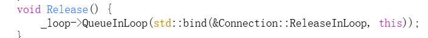

# Connection 与智能指针

本文只回答三个问题：

1. `Connection` 为什么需要智能指针？
2. 不用智能指针会怎样？
3. `shared_ptr`、`weak_ptr`、`unique_ptr`、裸指针分别怎么选？

不展开完整的 TCP 生命周期，只保留和所有权相关的部分。

---

## 1. 一句话结论

> `Connection` 有多个 owner，而且回调、定时器、跨线程任务可能比当前函数栈活得更久。  
> `shared_ptr` 用来表达共享所有权，`weak_ptr` 用来表达“只观察、不拥有”，`unique_ptr` 用来表达单一所有权，裸指针只用于生命周期确定的非拥有引用。

智能指针解决的是**生命周期**，不是线程安全。

---

## 2. Connection 的持有关系

```text
TcpServer::_conns
    └── shared_ptr<Connection>

HttpServerSession::_conn
    └── shared_ptr<Connection>

HttpResponseWriter 的 sink lambda
    └── 捕获 shared_ptr<Connection>，异步响应期间持有

EventLoop 的排队任务
    ├── Release 捕获的 self
    └── RemoveConnectionInSrvConns 任务里拷贝的 conn
```

所以：

> `TcpServer::_conns` 不是唯一 owner，`_conns.erase()` 也不等于立刻析构。

最后一个 `shared_ptr` 可能是：

- `_conns` 里的引用；
- `Release` 的 `self`；
- `RemoveConnectionInSrvConns` 任务里的 `conn`；
- `HttpServerSession::_conn`；
- 异步 writer 的 sink。

具体是谁，取决于关闭顺序和当前有多少异步操作。

---

## 3. 为什么需要智能指针

### 3.1 回调会超出当前函数栈

`Release()` 不能直接销毁自己：

```cpp
void Release()
{
    auto self = shared_from_this();

    _loop->QueueInLoop([self]() {
        ...
    });
}
```

`Release()` 返回时，任务还没执行。  
`self` 保证任务执行期间对象还活着。

如果这里不持有 `self`，任务真正执行时对象可能已经被析构。

### 3.2 多个模块需要共享连接

同一个 `Connection` 会被：

- `TcpServer::_conns` 管理；
- `HttpServerSession` 持有；
- 异步 writer 的 sink 捕获；
- EventLoop 的任务临时持有。

如果多个模块都认为自己拥有它，就要回答：

- 谁负责 delete？
- 什么时候 delete？
- 别的模块还在用怎么办？

`shared_ptr` 把答案统一成：

> 最后一个引用释放时析构。

### 3.3 跨线程任务需要保活

`Send()` 可能从其他线程调用：

```cpp
_loop->RunInLoop([this, buf]() mutable {
    if (_status == DISCONNECTED) return;
    ...
});
```

任务真正执行时，连接可能已经关闭。

当前 `Send()` 捕获的是裸 `this`，它依赖“关闭后不再 Send”的约定。  
更严格的做法是捕获 `shared_from_this()`，或者明确禁止关闭后调用 `Send()`。

### 3.4 `weak_ptr` 用来表达观察关系

`ProxySession` 的上游回调用的是 `weak_ptr`：

```cpp
std::weak_ptr<ProxySession> weak = shared_from_this();

_upstream->SetBodyCallback([weak](const char *data, size_t len) {
    if (auto self = weak.lock())
        self->OnUpstreamBody(data, len);
});
```

好处：

- 回调不需要拥有 `ProxySession`；
- 对象销毁后，回调安全忽略；
- 避免循环引用。

如果这里捕获 `shared_ptr`，容易形成：

```text
ProxySession -> callback -> shared_ptr<ProxySession>
```

对象永远不释放。

---

## 4. 不用智能指针会怎样

### 4.1 回调执行时对象已删除

```cpp
Connection *conn = new Connection(...);

loop->QueueInLoop([conn]() {
    conn->Send(...);
});

delete conn;
```

投递时合法，执行时悬空。

### 4.2 多个 owner 导致 double delete 或泄漏

```cpp
_conns.erase(id);
delete conn;

session->OnClosed();
delete conn;   // double free
```

或者双方都不 delete，就是泄漏。

### 4.3 在事件回调栈里 delete

```text
epoll_wait
  -> Channel::HandleEvent()
    -> Connection::HandleRead()
      -> Release()
        -> delete this
```

`Release()` 返回后，`Channel::HandleEvent()` 还在访问成员，use-after-free。

所以项目里 `Release()` 必须用 `QueueInLoop`。

### 4.4 定时器在连接关闭后触发

```cpp
_loop->AddTimertask(
    _conn_id, timeout,
    std::bind(&Connection::Release, this));
```

这里捕获的是裸 `this`。

如果连接析构前没有取消定时器，触发时就是悬空指针。

### 4.5 上游回调晚于 session 析构

```cpp
std::bind(&HttpClientSession::HandleClosed, this, _1)
```

`HttpClientSession` 必须活到 closed 回调触发。  
如果它先析构，底层 `Connection` 再回调就是访问已释放对象。

### 4.6 不用智能指针也能写，但要手动实现同样的机制

需要：

1. 一个明确的 owner；
2. 其他模块只拿非拥有指针；
3. 回调携带 id，通过 registry 查找；
4. 关闭时先摘 Channel、取消定时器、标记 closed；
5. 删除延迟到事件循环任务结束；
6. 保证没有 session、writer、upstream 回调还引用它。

这本质上是在手写一个更弱的 `shared_ptr` + `weak_ptr`。

---

## 5. 智能指针怎么选

| 场景 | 选择 | 项目中的例子 |
|---|---|---|
| 单一所有者 | `unique_ptr` | `ProxySession::_upstream` |
| 多方共享、异步保活 | `shared_ptr` | `Connection`、`HttpServerSession` |
| 只观察、不延长生命周期 | `weak_ptr` | `ProxySession` 的上游回调 |
| 非拥有、生命周期确定 | 裸指针/引用 | `Poller::_channels`、`Channel` 回调 |
| 对象是另一个对象的成员 | 直接成员 | `Connection::_channel` |

### 5.1 裸指针不是错误

`Poller` 里：

```cpp
std::unordered_map<int, Channel*> _channels;
```

`Channel` 是 `Connection` 的成员，`Poller` 只是观察它，不需要共享所有权。

但前提是：

> `Release()` 必须先 `_channel.Remove()`，再让 `Connection` 析构。

### 5.2 不要用 `shared_ptr` 制造循环引用

```cpp
conn->SetClosedCallback([conn]() {
    // Connection 自己持有自己
});
```

这样永远不会释放。

观察者/回调应该用 `weak_ptr`，或者明确不拥有。

### 5.3 `shared_ptr` 不是线程安全对象

引用计数是原子的，但对象成员不是。

`Connection` 仍然是 loop-affine 的：

- 读写事件在所属 loop；
- 跨线程 `Send` 要拷贝数据再投递；
- 其他线程不能直接改 `_out_buffer`。

---

## 6. 智能指针的局限

智能指针不能替代下面这些东西：

1. **关闭状态机**  
   对象还活着，不代表它还能收发数据。

2. **Channel / fd / 定时器的显式清理**  
   `shared_ptr` 不会自动从 Poller 摘 Channel，也不会自动取消定时器。

3. **半关闭、超时、背压**  
   这些是协议和连接管理问题，不是所有权问题。

4. **线程安全**  
   `shared_ptr` 只保护引用计数，不保护 `Connection` 的成员。

5. **所有回调都安全**  
   当前代码里仍有裸 `this`：
   - `Channel` 回调；
   - `TimerWheel` 回调；
   - `Connection::Send()` 的排队 lambda。

所以“用了智能指针”不等于“没有生命周期问题”，还要保证清理顺序和回调约定。

---

## 7. 面试问答

### Q1：为什么 `Connection` 用 `shared_ptr`？

因为 `Connection` 有多个 owner，而且回调、定时器、跨线程任务可能比当前函数栈活得更久。  
`shared_ptr` 保证最后一个引用释放时才析构。

### Q2：不用智能指针会怎样？

最容易出的是 use-after-free：

- 回调晚于对象析构；
- 在 `Channel::HandleEvent()` 栈里 delete；
- 跨线程任务拿到裸 `this`；
- 定时器在连接关闭后触发；
- 多个 owner 重复 delete 或没人 delete。

### Q3：`_conns.erase()` 会立刻析构 `Connection` 吗？

不会。

`_conns` 只是其中一个 owner。  
`HttpServerSession`、异步 writer 的 sink、`Release` 的 `self`、`RemoveConnectionInSrvConns` 任务都可能还持有连接。

引用计数归零时才析构。

### Q4：`Shutdown()` 和 `Release()` 的区别？

- `Shutdown()`：标记关闭，等输出缓冲区发完再 `Release()`；
- `Release()`：真正销毁，摘 Channel、关 fd、取消定时器、回调清理。

`Shutdown()` 不是 `shutdown(2)`，不是 TCP 半关闭。

### Q5：为什么 `Release()` 要 `QueueInLoop`？

因为 `Release()` 可能在 `Channel::HandleEvent()` 的调用栈里。  
同步 delete 会让回调返回后的代码访问已释放对象。

### Q6：为什么 `Send()` 要先拷贝数据？

因为 `Send()` 可能跨线程调用。  
如果只捕获 `data` 指针，任务执行时临时内存可能已经释放。

### Q7：为什么 `ProxySession` 的回调用 `weak_ptr`？

- 上游回调不需要拥有 `ProxySession`；
- 避免循环引用；
- 对象销毁后，`weak.lock()` 返回空，回调安全忽略。

### Q8：`shared_ptr` 是线程安全的吗？

引用计数是原子的，但对象本身不是。

`Connection` 仍然要回到所属 loop 操作。

### Q9：`Channel`、`Poller`、`TimerWheel` 为什么用裸指针？

它们是非拥有引用：

- `Channel` 是 `Connection` 的成员；
- `Poller` 只观察 `Channel`；
- `TimerWheel` 只回调 `Connection`。

前提是 `Release()` 先摘 Channel、取消定时器，再让对象析构。

### Q10：如果不用智能指针，怎么设计？

一个明确的 owner + registry + 连接 id + 延迟删除 + 回调失效 + 定时器取消。  
本质上就是手动实现引用计数和弱引用。

---

## 8. 一句话总结

> `shared_ptr` 解决“多个模块共同拥有连接，最后一个负责销毁”；  
> `weak_ptr` 解决“回调只观察、不拥有”；  
> `unique_ptr` 解决“只有一个 owner”；  
> 裸指针只用于“生命周期确定、不拥有”的地方。

但智能指针只解决生命周期，不解决：

- 线程安全；
- 关闭状态机；
- Channel / 定时器清理；
- 半关闭、超时、背压。


回调函数也可以持有shared_ptr，回调函数对象可以捕获ptrconnection然后放入任务队列
